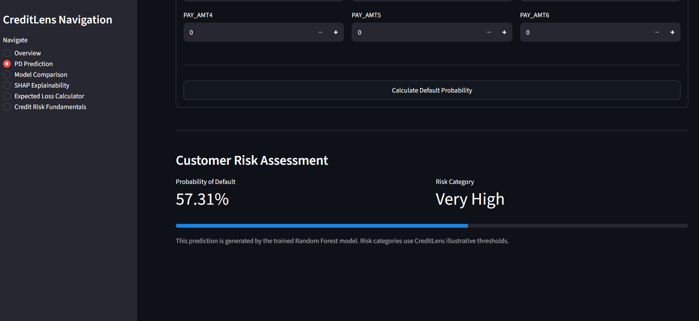

# CreditLens
### Credit Risk Assessment & Explainability Platform

CreditLens is a machine learning-based credit risk assessment application that estimates the probability of credit card default and explains individual predictions using Explainable AI (SHAP).

The project demonstrates a practical credit risk modelling workflow, from data preprocessing and model training to evaluation, prediction and model explainability, through an interactive Streamlit dashboard.

## Key Features

- **Credit Default Prediction:** Estimate the probability of customer default using a trained Random Forest model.
- **Model Comparison:** Compare Logistic Regression and Random Forest using standard classification metrics.
- **Individual Explainability:** Use SHAP to understand which customer features contribute to an individual prediction.
- **Global Explainability:** Identify the features that have the greatest influence on model predictions across a sample of customers.
- **Expected Credit Loss Calculator:** Calculate simplified ECL using model-predicted PD and user-provided LGD and EAD assumptions.
- **Credit Risk Fundamentals:** Explore PD, LGD, EAD, ECL and the basic IFRS 9 staging framework.

## Technology Stack

| Category | Technologies |
|---|---|
| Programming Language | Python |
| Data Processing | Pandas, NumPy |
| Machine Learning | Scikit-learn |
| Explainable AI | SHAP |
| Dashboard | Streamlit |
| Visualisation | Plotly |
| Model Persistence | Joblib |
| Testing | Pytest |
| Version Control | Git, GitHub |

## Machine Learning Models

CreditLens implements two classification models:

1. **Logistic Regression** – baseline classification model.
2. **Random Forest** – main model used for customer default probability predictions.

Both models are trained and evaluated using the same stratified train/test split.

### Model Evaluation Results

Results from the current implementation:

| Metric | Logistic Regression | Random Forest |
|---|---:|---:|
| Accuracy | 0.6797 | 0.7778 |
| Precision | 0.3672 | 0.4981 |
| Recall | 0.6202 | 0.5931 |
| F1-score | 0.4613 | 0.5415 |
| ROC-AUC | 0.7081 | 0.7747 |

Random Forest achieves stronger results in accuracy, precision, F1-score and ROC-AUC. Logistic Regression achieves slightly higher recall.

These results are specific to the dataset, preprocessing pipeline, model configuration and evaluation split used in this project.

## Explainable AI with SHAP

CreditLens uses SHAP (SHapley Additive exPlanations) to interpret Random Forest predictions.

The explainability functionality includes:

- Global feature importance based on mean absolute SHAP values.
- Individual customer explanations.
- Identification of features that increase or decrease predicted default risk.
- Visual explanations using Plotly.

SHAP values describe how features contribute to the model's predictions. They do not establish causal relationships.

## Expected Credit Loss Calculator

The application includes an educational Expected Credit Loss calculator.

The simplified calculation is:

**ECL = PD × LGD × EAD**

Where:

- **PD (Probability of Default):** Obtained from the Random Forest prediction.
- **LGD (Loss Given Default):** Supplied by the user as an assumption.
- **EAD (Exposure at Default):** Supplied by the user as an assumption.

The calculator can use the latest predicted PD or a manually entered PD.

**Important:** This is a simplified educational calculation, not a complete IFRS 9 expected credit loss implementation.

## Dataset

The project uses the **Default of Credit Card Clients** dataset from the UCI Machine Learning Repository.

- Dataset size: 30,000 customer records.
- Original columns: 25.
- Model input features: 23, after removing the customer ID and target column.
- Target: Default payment next month.
- Classification task: Binary classification.

Dataset source:

https://archive.ics.uci.edu/dataset/350/default+of+credit+card+clients

The dataset contains historical credit card customer information from Taiwan. Its results should not automatically be generalised to other countries, lenders or current credit portfolios.

The dataset is not included in this repository. Download it separately and place the Excel file at:

`data/raw/credit_card_default.xls`

## Project Structure

```text
creditlens-credit-risk-platform/
│
├── app/
│   ├── components/
│   └── main.py
│
├── data/
│   ├── raw/
│   └── processed/
│
├── docs/
│
├── models/
│
├── screenshots/
│   └── pd_prediction_demo.png
│
├── src/
│   └── creditlens/
│       ├── data/
│       │   └── preprocessing.py
│       │
│       ├── models/
│       │   ├── training.py
│       │   ├── run_training.py
│       │   └── evaluation.py
│       │
│       ├── prediction/
│       │   └── predictor.py
│       │
│       ├── explainability/
│       │   └── shap_explainer.py
│       │
│       ├── database/
│       │
│       └── config.py
│
├── tests/
│   ├── test_prediction.py
│   └── test_explainability.py
│
├── requirements.txt
├── README.md
└── .gitignore
```

## Installation and Setup

### 1. Clone the repository

```bash
git clone https://github.com/sainamas/creditlens-credit-risk-platform.git
cd creditlens-credit-risk-platform
```

### 2. Create a virtual environment

Windows PowerShell:

```powershell
python -m venv .venv
.venv\Scripts\Activate.ps1
```

### 3. Install dependencies

```powershell
pip install -r requirements.txt
```

### 4. Add the dataset

Download the UCI dataset and place the Excel file at:

```text
data/raw/credit_card_default.xls
```

### 5. Train the models

In Windows PowerShell:

```powershell
$env:PYTHONPATH="src"
python -m creditlens.models.run_training
```

This trains Logistic Regression and Random Forest, evaluates both models and saves the trained model files in the `models/` directory.

### 6. Launch the dashboard

```powershell
$env:PYTHONPATH="src"
python -m streamlit run app/main.py
```

The application will open in your browser at:

`http://localhost:8501`

## Dashboard Sections

The Streamlit application includes:

1. **Overview** – Introduction and project summary.
2. **PD Prediction** – Enter customer information and estimate default probability.
3. **Model Comparison** – Compare the implemented machine learning models.
4. **SHAP Explainability** – Explore global feature importance and individual customer explanations.
5. **Expected Loss Calculator** – Calculate simplified expected credit loss.
6. **Credit Risk Fundamentals** – Understand the core concepts behind credit risk assessment.

## Application Screenshot



## Testing

The project uses Pytest for automated testing.

Run the test suite:

```powershell
$env:PYTHONPATH="src"
python -m pytest tests -v
```

**Latest test result:**
- 10 tests passed.
- 0 test failures.
- Tests cover prediction validation, risk classification, SHAP explainer creation, individual explanations, global feature importance and chart generation.

## Current Limitations

- The models use a historical Taiwan credit card dataset.
- Only Probability of Default is predicted using machine learning.
- LGD and EAD are user-provided assumptions.
- The ECL calculator is simplified and is not a full IFRS 9 implementation.
- The project is an educational demonstration and is not intended for real-world lending decisions.

## Future Improvements

Potential extensions include:

- Probability calibration and decision threshold analysis.
- Additional model evaluation and validation.
- Improved treatment of categorical and ordinal features.
- Expanded explainability and model diagnostics.
- Model monitoring and drift analysis.
- Deployment to a cloud platform.

## Disclaimer

CreditLens is an educational machine learning project developed to demonstrate credit risk modelling and explainability concepts. It is not a production credit scoring system and should not be used to make actual lending or financial decisions.