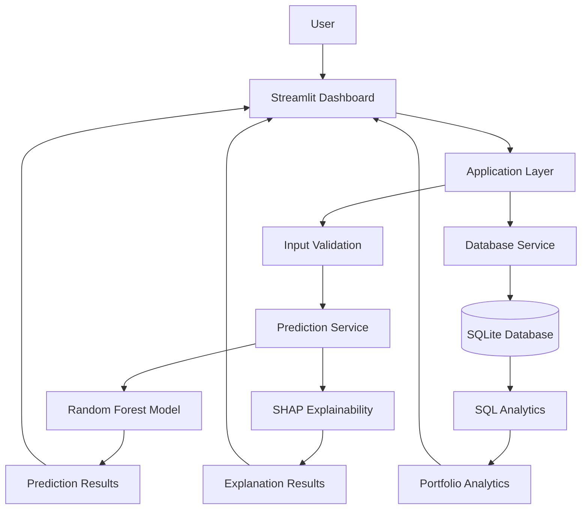
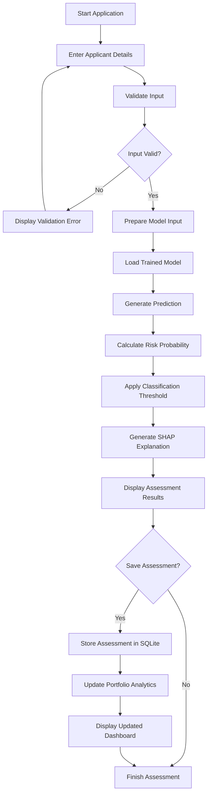
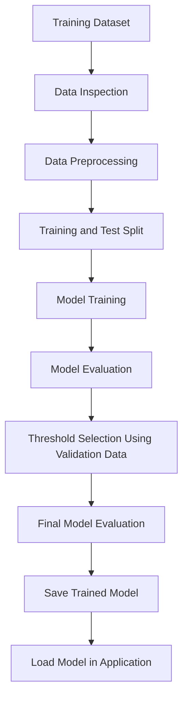

# CreditLens – System Architecture

## 1. Project Overview

CreditLens is a machine learning-based credit risk assessment and explainability platform.

The application aims to help users assess loan default risk, understand the factors influencing individual predictions and analyse credit assessment records.

The system combines machine learning, explainable AI, database management and interactive data visualisation.

This document describes the proposed system architecture before implementation.

## 2. Architecture Design Principles

The application will follow these principles:

- Simple and modular architecture.
- Clear separation of responsibilities.
- Reusable Python components.
- Beginner-friendly implementation.
- Minimal unnecessary dependencies.
- Easy local execution on Windows.
- Actual backend-generated results.
- Testable individual components.

The initial implementation will use a single Python application rather than a microservices architecture.

## 3. Proposed Technology Stack

| Component | Technology | Responsibility |
|---|---|---|
| Programming Language | Python | Main application logic |
| User Interface | Streamlit | Interactive dashboard |
| Data Processing | pandas, NumPy | Data preparation |
| Machine Learning | scikit-learn | Random Forest classification |
| Explainable AI | SHAP | Prediction explanations |
| Database | SQLite | Assessment storage |
| Database Queries | SQL | Portfolio analytics |
| Visualisation | Plotly | Interactive charts |
| Testing | pytest | Automated testing |
| Version Control | Git, GitHub | Source code management |

## 4. Proposed System Architecture

The following diagram represents the planned system architecture. All components and connections must be verified against the actual implementation after development.



## 5. Main System Components

### 5.1 User Interface

Technology: Streamlit

Responsibilities:

- Display the CreditLens dashboard.
- Collect applicant information.
- Provide prediction controls.
- Display credit risk predictions.
- Visualise SHAP explanations.
- Display loan portfolio analytics.
- Show previous assessment records.

### 5.2 Application Layer

Technology: Python

Responsibilities:

- Coordinate application operations.
- Connect the user interface to individual modules.
- Validate applicant information.
- Call the prediction service.
- Request SHAP explanations.
- Coordinate database operations.

### 5.3 Data Processing

Technologies: pandas and NumPy

Responsibilities:

- Load and inspect the training dataset.
- Handle missing or invalid values where required.
- Prepare model input features.
- Apply consistent preprocessing.
- Ensure prediction inputs follow the model's expected format.

### 5.4 Machine Learning Module

Technology: scikit-learn

Algorithm: Random Forest Classifier

Responsibilities:

- Train the credit risk classification model.
- Evaluate model performance.
- Generate default risk predictions.
- Calculate prediction probabilities.
- Apply the selected classification threshold.

Model evaluation will include appropriate classification metrics such as ROC-AUC, precision, recall and F1-score.

### 5.5 Explainability Module

Technology: SHAP

Responsibilities:

- Explain individual model predictions.
- Identify important contributing features.
- Display positive and negative feature contributions.
- Help users understand how applicant information influences model predictions.

SHAP explanations will be generated using the trained model and its actual input features.

### 5.6 Database Module

Technology: SQLite

Responsibilities:

- Store completed credit assessments.
- Maintain assessment identifiers.
- Store relevant prediction results.
- Retrieve previous assessments.
- Support portfolio analytics.

Database operations will be separated from the main application logic.

### 5.7 SQL Analytics Module

Technology: SQL

Responsibilities:

- Calculate the number of assessments.
- Analyse risk category distributions.
- Group assessments by relevant applicant attributes.
- Generate loan portfolio summaries.
- Retrieve historical assessment information.

### 5.8 Visualisation Module

Technology: Plotly

Responsibilities:

- Display portfolio risk distributions.
- Visualise model evaluation metrics.
- Present SHAP feature contributions.
- Display relevant historical trends.

All visualisations must use actual application or model data.

## 6. Proposed Application Workflow

The following diagram describes the planned applicant assessment workflow.



## 7. Model Development Workflow

Model development will be performed separately from normal application execution.



The training process and application prediction process will be separated to avoid retraining the model every time the dashboard starts.

## 8. Data Flow

The proposed data flow is:

1. The user enters applicant information through Streamlit.
2. The application validates the submitted information.
3. The data processing module prepares the input.
4. The prediction service passes the prepared input to the trained Random Forest model.
5. The model generates a prediction probability.
6. The selected classification threshold determines the predicted class.
7. SHAP generates an explanation for the individual prediction.
8. The application displays the prediction and explanation.
9. The user can save the assessment.
10. The database stores the assessment.
11. SQL queries retrieve records for portfolio analytics.
12. The dashboard displays updated analytics.

## 9. Proposed Project Module Structure

The planned source code organisation is:

```text
creditlens-credit-risk-platform/
│
├── app/
│   ├── main.py
│   └── components/
│
├── src/
│   └── creditlens/
│       ├── data/
│       ├── models/
│       ├── prediction/
│       ├── explainability/
│       ├── database/
│       └── analytics/
│
├── database/
├── tests/
├── benchmarks/
├── docs/
│   └── architecture.md
│
├── screenshots/
├── README.md
├── requirements.txt
└── .gitignore
```

This is a proposed structure. It may be refined during implementation to avoid unnecessary folders and files.

## 10. Security and Data Handling

The application will follow basic data handling practices:

- Validate all user inputs.
- Avoid storing unnecessary personal information.
- Keep database operations controlled.
- Avoid committing private applicant data.
- Exclude database files containing personal information from GitHub.
- Document the educational limitations of model predictions.

The project is intended for educational demonstration and is not a production lending decision system.

## 11. Testing Strategy

The following areas will be tested:

- Input validation.
- Data preprocessing.
- Model prediction.
- Classification threshold handling.
- SHAP explanation generation.
- Database insertion and retrieval.
- SQL portfolio analytics.
- Application integration.
- Invalid and missing inputs.

pytest will be used for automated testing.

## 12. Performance and Evaluation

Relevant measurements will include:

- ROC-AUC.
- Accuracy.
- Precision.
- Recall.
- F1-score.
- Prediction execution time.
- SHAP explanation execution time.
- Database query execution time.

Actual results will be recorded after implementation and testing.

No performance figures will be assumed or fabricated.

## 13. Implementation Status

**Current Status: Proposed Architecture**

The architecture and workflows in this document represent the planned design.

After implementation:

1. Verify each component against the actual source code.
2. Verify all communication paths.
3. Update diagrams to match the working application.
4. Remove the Proposed labels.
5. Record any architectural changes.
6. Commit the verified documentation to GitHub.

## 14. Future Improvements

Potential future improvements include:

- Additional machine learning models.
- Improved model monitoring.
- More advanced portfolio analytics.
- Expanded model explainability.
- Separate API services if future requirements justify them.
- Public application deployment.

These improvements will only be introduced when they provide genuine value.
